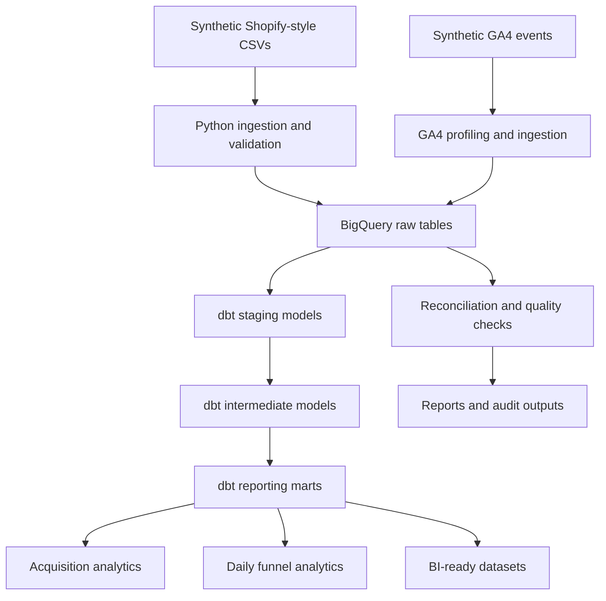

# Puffy Growth Analytics Platform

An end-to-end e-commerce analytics engineering portfolio project simulating how a growth and data team can ingest operational and behavioral data, validate data quality, reconcile inventory and revenue, model customer journeys, and produce reliable acquisition and conversion analytics.

The platform combines Python, Shopify Admin GraphQL API, BigQuery, dbt, SQL, automated testing, and reproducible synthetic datasets.

> **Project status:** Portfolio simulation with implemented and tested ingestion, reconciliation, validation, and analytics workflows. This is not a claim of a production deployment.

## Table of Contents

- [Project Overview](#project-overview)
- [Architecture](#architecture)
- [Technology Stack](#technology-stack)
- [Implemented Workflows](#implemented-workflows)
- [GA4 Growth Analytics](#ga4-growth-analytics)
- [Data Quality and Validation](#data-quality-and-validation)
- [Setup and Configuration](#setup-and-configuration)
- [Run the Project](#run-the-project)
- [Key Metrics and Definitions](#key-metrics-and-definitions)
- [Repository Structure](#repository-structure)
- [Security and Data Governance](#security-and-data-governance)
- [Known Limitations](#known-limitations)
- [Roadmap](#roadmap)

## Project Overview

The platform simulates an e-commerce business that needs consistent, trustworthy data across commerce operations and digital customer behavior.

The implemented workflows cover:

- **Data ingestion:** Load synthetic product, customer, order, order-item, and GA4 event datasets into the analytics environment.
- **Inventory reconciliation:** Compare product inventory against a Shopify development store and identify discrepancies.
- **Customer and order validation:** Check identifiers, required fields, relationships, timestamps, statuses, and financial values.
- **Revenue reconciliation:** Compare order-level financial values with item-level calculations using the synthetic dataset's documented financial rules.
- **Analytics engineering:** Transform raw behavioral events into standardized staging models, session-level facts, and daily reporting marts using dbt.
- **Growth analytics:** Analyze acquisition performance, customer journeys, funnel progression, purchase-event activity, and page-performance indicators.
- **Automated testing:** Apply Python tests and dbt data tests to validate transformations and data quality.

All synthetic-data findings are illustrative. They do not represent the actual performance of Puffy or any other real business.

## Architecture



### Data flow

1. Synthetic source data is prepared in CSV format.
2. Python scripts validate source data and load selected datasets into BigQuery.
3. BigQuery stores raw source tables in the `growthanalytics` dataset.
4. dbt standardizes event fields and derives session-level metrics.
5. dbt marts aggregate funnel and acquisition metrics for reporting.
6. Data tests and reconciliation queries validate record counts, uniqueness, required fields, and modeled totals.
7. The resulting tables can support downstream BI dashboards and business analysis.

## Technology Stack

| Area | Technologies |
|---|---|
| Programming and analysis | Python 3.12, Pandas |
| Commerce integration | Shopify Admin GraphQL API |
| Cloud data warehouse | Google BigQuery |
| Analytics engineering | dbt Core, dbt BigQuery adapter, SQL |
| Data quality | pytest, dbt data tests, reconciliation queries |
| Data sources | Synthetic CSV datasets, GA4-style behavioral events |
| Version control | Git, GitHub |
| Reporting foundation | BI-ready daily acquisition and funnel marts |

## Implemented Workflows

### 1. Shopify Inventory Reconciliation

The inventory workflow compares the synthetic product catalogue against quantities retrieved from a Shopify development store.

The workflow:

1. Reads source product inventory.
2. Retrieves Shopify products, variants, and inventory quantities.
3. Matches records using SKU.
4. Identifies missing or duplicate SKUs, unmatched records, and quantity discrepancies.
5. Produces a reconciliation report.
6. Supports controlled inventory updates when explicitly requested.
7. Records attempted updates in an audit log.

The default execution mode is a dry run. Inventory updates require the explicit `--apply` option.

#### Verified inventory test run

| Metric | Result |
|---|---:|
| Products reconciled | 100 |
| Products matching after synchronization | 100 |
| Final match rate | 100% |
| Remaining quantity mismatches | 0 |
| Remaining exceptions | 0 |
| Mismatches corrected | 99 |
| Absolute quantity variance before synchronization | 267,285 units |
| Absolute quantity variance after synchronization | 0 units |

These results describe the development-store test run performed on October 12, 2026. The synthetic source file was authoritative for this demonstration; matching quantities do not prove physical stock accuracy.

### 2. Customer Data Validation

The customer validation workflow checks the integrity of customer records before downstream analytics.

Checks include:

- Required fields and missing or blank values.
- Missing or duplicate customer identifiers.
- Valid customer types, countries, and acquisition-source fields.
- Parseable first-purchase dates.
- Non-negative lifetime order counts and lifetime revenue.
- Valid marketing opt-in values.

Missing loyalty tiers are permitted under the project's validation rules.

| Metric | Result |
|---|---:|
| Customer records validated | 25,000 |
| Validation errors | 0 |
| Automated tests | 9 |

### 3. Order and Order-Item Validation

The order validation workflow checks order records and their relationships with customers, products, and order items.

Checks include:

- Required fields and duplicate identifiers.
- Order-to-customer relationships.
- Item-to-order and item-to-product relationships.
- Parseable order timestamps.
- Valid order and fulfillment statuses.
- Numeric and non-negative financial values.
- Valid item quantities and monetary values.

Negative item gross margins are permitted because they may represent loss-making transactions.

| Metric | Result |
|---|---:|
| Order records validated | 30,000 |
| Order-item records validated | 30,000 |
| Invalid references found in initial checks | 0 |
| Validation errors | 0 |
| Automated tests | 11 |

### 4. Revenue Reconciliation

The revenue reconciliation workflow aggregates item-level revenue by order, compares it with order-level financial fields, and flags differences outside a configurable tolerance.

For this synthetic dataset, the defined rules are:

**Expected item revenue**

`Subtotal - Discount`

**Expected net revenue**

`Subtotal - Discount + Shipping + Tax - Refund Amount`

These formulas reflect this project's synthetic data conventions. Real e-commerce accounting and revenue recognition may require additional business-specific rules.

| Metric | Result |
|---|---:|
| Orders analyzed | 30,000 |
| Orders without item records | 0 |
| Item revenue mismatches | 0 |
| Net revenue mismatches | 0 |
| Net revenue match rate across order statuses | 100% |

The reconciliation covers paid, fulfilled, partially refunded, refunded, and cancelled orders.

The script `scripts/check_revenue_reconciliation.py` generates:

- `data/processed/revenue_reconciliation.csv`
- `data/processed/revenue_reconciliation_summary.csv`

These outputs are generated locally and excluded from Git.

## GA4 Growth Analytics

The GA4 workflow extends the project from operational data validation into behavioral analytics engineering.

It uses a synthetic GA4-style event dataset to model customer journeys and produce daily acquisition and funnel reporting tables.

### Dataset profile

| Metric | Verified result |
|---|---:|
| Event records | 520,000 |
| Unique event IDs | 520,000 |
| Unique users | 25,000 |
| Unique sessions | 170,061 |
| Purchase events | 27,236 |
| Event columns | 20 |
| Event date range | June 1 – July 30, 2026 |
| Missing values found during profiling | 0 |

The dataset includes event names, timestamps, users, sessions, page locations, device and geographic attributes, traffic source and medium, campaigns, product IDs, experiment fields, engagement seconds, scroll depth, and page-load duration.

Example events include:

- `session_start`
- `view_item`
- `add_to_cart`
- `begin_checkout`
- `add_payment_info`
- `purchase`
- `view_reviews`
- `click_shipping`
- `click_size_guide`
- `exit_intent`

The dataset is synthetic and should not be interpreted as actual website analytics.

### BigQuery ingestion

The GA4 loader is located at:

`src/ingestion/load_ga4_events_to_bigquery.py`

It loads the CSV into:

`puffy-platform.growthanalytics.raw_ga4_events`

The loader uses a service-account key path supplied through the `DBT_GOOGLE_KEYFILE` environment variable. The key file itself is kept outside the repository.

**Important:** The current loader uses `WRITE_TRUNCATE`, which replaces the destination table on each run. It is designed for reproducible portfolio loading, not incremental production ingestion.

### dbt models

The current GA4 modeling layer contains the following models.

| Layer | Model | Purpose |
|---|---|---|
| Staging | `stg_ga4_events` | Standardizes event names, timestamps, dates, dimensions, and numeric fields |
| Intermediate | `fct_ga4_sessions` | Produces one record per session and derives session metrics |
| Mart | `mart_ga4_funnel_daily` | Aggregates daily funnel-stage sessions and conversion rates |
| Mart | `mart_ga4_acquisition_daily` | Aggregates sessions, users, funnel activity, and purchase metrics by acquisition dimensions |

The session model derives session start and end timestamps, event counts, event-level engagement totals, page-load indicators, scroll-depth metrics, and purchase-event flags.

Traffic and device attributes are selected deterministically from the first non-null observation in each session, ordered by event timestamp and event ID. This provides a reproducible modeling rule; it does not resolve inconsistencies present in the synthetic source data.

### Funnel metrics

The daily funnel mart measures distinct sessions reaching each stage:

1. Product view
2. Add to cart
3. Begin checkout
4. Add payment information
5. Purchase event

It supports metrics such as:

- Product-view-to-cart rate.
- Cart-to-checkout rate.
- Checkout-to-purchase rate.
- Session purchase-event rate.
- Average session duration.
- Event-level engagement totals.
- Average page-load duration.

Stage conversion rates use the relevant upstream stage as the denominator. Session purchase-event rate uses total sessions as the denominator.

### Acquisition analysis

The acquisition mart supports comparisons across traffic source, medium, campaign, device category, country, landing page, and date.

A sample aggregation from the modeled dataset produced these results:

| Traffic source | Medium | Sessions | Purchase sessions | Session purchase rate |
|---|---|---:|---:|---:|
| Google | CPC | 47,577 | 6,926 | 14.56% |
| Meta | Paid social | 42,539 | 6,342 | 14.91% |
| Organic | Organic | 30,375 | 4,553 | 14.99% |
| Direct | None | 25,554 | 3,858 | 15.10% |
| Affiliate | Affiliate | 13,672 | 2,040 | 14.92% |
| Email | Email | 10,344 | 1,573 | 15.21% |

These are descriptive results from the synthetic dataset, not evidence that a channel caused higher conversion. Small differences should not be interpreted as statistically significant without a suitable experimentation or statistical analysis design.

A purchase session is a session containing at least one purchase event. Purchase-event counts may exceed purchase-session counts because one session can contain multiple purchase events.

### dbt validation and reconciliation

The latest full dbt build completed successfully with:

| Validation metric | Result |
|---|---:|
| dbt models discovered | 12 |
| dbt data tests discovered | 61 |
| Total build tasks passed | 73 |
| Warnings | 0 |
| Errors | 0 |

The raw-to-modeled reconciliation also matched:

| Measure | Raw | Modeled |
|---|---:|---:|
| Events | 520,000 | 520,000 |
| Sessions | 170,061 | 170,061 |
| Purchase events | 27,236 | 27,236 |

This confirms record-count consistency for the tested pipeline. It does not independently establish the correctness of every business metric or the validity of the underlying synthetic data.

## Data Quality and Validation

The project combines validation at multiple levels:

**Source validation**
- Required fields and data types.
- Missing values and duplicate identifiers.
- Referential integrity between customers, orders, products, and order items.
- Valid timestamps, quantities, statuses, and financial fields.

**Analytics engineering validation**
- Unique and non-null keys.
- Required session and event attributes.
- Daily mart key and metric checks.
- Raw-to-modeled record-count reconciliation.

**Operational controls**
- Dry-run-first inventory reconciliation.
- Explicit opt-in for inventory updates.
- Local reconciliation reports and audit logs.
- Environment-based credentials rather than committed secrets.

The Python test suite currently covers inventory reconciliation, customer validation, order validation, and revenue reconciliation.

| Test module | Tests |
|---|---:|
| Inventory reconciliation | 11 |
| Customer validation | 9 |
| Order validation | 11 |
| Revenue reconciliation | 5 |
| **Total Python tests** | **36** |

The latest recorded result for this Python suite was 36 passing tests. The 73-task dbt build is a separate result and should not be added to the Python test count.

## Setup and Configuration

### Prerequisites

- Python 3.12 or a compatible Python environment.
- Git.
- A Google Cloud project with BigQuery enabled for the warehouse workflows.
- A configured service account with the required BigQuery permissions for ingestion and dbt.
- A Shopify development store and appropriately scoped credentials for Shopify workflows.

### 1. Clone the repository

```bash
git clone https://github.com/purehibiscus/puffy-growth-analytics-platform.git
cd puffy-growth-analytics-platform
```

### 2. Install Python dependencies

```bash
python -m pip install -r requirements.txt
```

### 3. Configure Shopify credentials when needed

Create a local `.env` file from `.env.example` and provide your own development-store values.

Never commit the real `.env` file.

### 4. Configure BigQuery credentials

Configure the `puffy_platform` dbt profile in:

`%USERPROFILE%\.dbt\profiles.yml`

The profile should specify the BigQuery project, dataset, location, service-account authentication, and the environment variable used for the key file.

Set the key-file environment variable in Windows Anaconda Prompt:

```bat
set "DBT_GOOGLE_KEYFILE=%USERPROFILE%\.google\puffy-platform-dbt-key.json"
```

Use the actual local path to your service-account key if it differs.

The service-account JSON must remain outside the repository. Do not paste credentials into source code, README files, or issue reports.

### 5. Verify the dbt connection

From the repository root:

```bat
cd dbt\puffy_platform
dbt debug
```

Return to the repository root when running root-level Python scripts.

## Run the Project

### Run the Python test suite

From the repository root:

```bash
python -m pytest -q
```

### Generate revenue reconciliation reports

```bash
python scripts/check_revenue_reconciliation.py
```

The script reads the synthetic order and order-item datasets and writes reports under `data/processed/`.

### Preview inventory reconciliation

```bash
python -m src.ingestion.sync_shopify_inventory
```

Review the reconciliation output before making any changes.

**Caution:** The following command applies inventory changes to the configured Shopify store:

```bash
python -m src.ingestion.sync_shopify_inventory --apply
```

Only run it when you have verified the development-store configuration, permissions, and intended inventory quantities.

### Profile the GA4 dataset

From the repository root:

```bash
python scripts/profile_ga4_events.py
```

The script reads the CSV in chunks to calculate event counts, distinct users and sessions, event-ID checks, missing-value information, and timestamp coverage without loading the entire file into memory at once.

### Load GA4 events into BigQuery

Ensure `DBT_GOOGLE_KEYFILE` is configured and the destination dataset exists, then run from the repository root:

```bash
python src/ingestion/load_ga4_events_to_bigquery.py
```

**Warning:** The current loader replaces `raw_ga4_events` using `WRITE_TRUNCATE`. Do not rerun it against a table containing data that must be retained.

### Run dbt transformations and tests

From the dbt project directory:

```bash
cd dbt/puffy_platform
dbt debug
dbt parse
dbt build
```

To build the session model and two GA4 marts with their selected dependencies and tests:

```bash
dbt build --select fct_ga4_sessions mart_ga4_funnel_daily mart_ga4_acquisition_daily
```

The commands above require a working BigQuery connection and the configured dbt profile.

## Key Metrics and Definitions

| Metric | Definition |
|---|---|
| Sessions | Distinct session identifiers |
| Purchase sessions | Sessions containing at least one purchase event |
| Purchase events | Number of events named `purchase` |
| Session purchase-event rate | Purchase sessions divided by total sessions |
| Stage conversion rate | Sessions reaching the next stage divided by sessions reaching the preceding stage |
| Event engagement total | Sum of event-level engagement seconds in the modeled session |
| Inventory variance | Difference between the source quantity and the retrieved Shopify quantity |
| Revenue variance | Difference between expected and recorded financial values under the project's defined rules |

Metric definitions should be reviewed before comparing them with GA4 reports, Shopify analytics, or finance systems. Different tools may use different sessionization, attribution, revenue, and event-counting rules.

## Repository Structure

```text
.
├── data/
│   ├── synthetic/                 # Synthetic source datasets
│   └── processed/                 # Local generated reports; Git-ignored
├── dbt/
│   └── puffy_platform/
│       ├── models/
│       │   ├── staging/
│       │   │   ├── stg_ga4_events.sql
│       │   │   ├── schema.yml
│       │   │   └── sources.yml
│       │   ├── intermediate/
│       │   │   ├── fct_ga4_sessions.sql
│       │   │   └── schema.yml
│       │   └── marts/
│       │       ├── mart_ga4_acquisition_daily.sql
│       │       ├── mart_ga4_funnel_daily.sql
│       │       └── schema.yml
│       └── dbt_project.yml
├── scripts/
│   ├── check_revenue_reconciliation.py
│   └── profile_ga4_events.py
├── src/
│   ├── ingestion/
│   │   ├── load_ga4_events_to_bigquery.py
│   │   ├── reconcile_revenue.py
│   │   ├── validate_customers.py
│   │   ├── validate_orders.py
│   │   └── sync_shopify_inventory.py
│   ├── validation/
│   └── warehouse/
├── tests/
├── .env.example
├── .gitignore
├── requirements.txt
└── README.md
```

This is a representative structure; additional files and project areas may exist in the repository.

## Security and Data Governance

- Never commit `.env`, service-account JSON files, API keys, access tokens, or client secrets.
- Use least-privilege service accounts and Shopify API scopes.
- Keep generated operational reports and local credentials outside version control.
- Use synthetic data for portfolio demonstrations.
- Review destructive warehouse operations before execution.
- Treat the current GA4 dataset and all metrics derived from it as synthetic.

## Known Limitations

1. **Synthetic behavioral data:** The GA4-style event stream is simulated, not collected from a live website.
2. **Session attribution consistency:** Multiple source values occur within some synthetic sessions. The model applies a deterministic first-observed rule, but the source inconsistencies remain.
3. **No reliable transaction-level join yet:** The current GA4 event schema does not contain a reliable transaction ID or purchase revenue field for matching purchase events to Shopify orders.
4. **Purchase events are not verified orders:** A `purchase` event should not be treated as a confirmed Shopify transaction without transaction-level reconciliation.
5. **Full-refresh ingestion:** The current GA4 loader replaces the raw table rather than implementing incremental, partitioned ingestion.
6. **No production orchestration claim:** The project does not yet demonstrate a fully deployed, continuously scheduled production pipeline.
7. **No causal attribution claim:** Differences between synthetic acquisition channels are descriptive and do not establish causal lift.
8. **Synthetic financial rules:** Revenue reconciliation follows the project's specified conventions and is not a substitute for a business-specific accounting policy.

## Roadmap

- Document and validate the original synthetic-data generation workflow.
- Retain a small, representative GA4 sample for easier repository cloning and reproducibility.
- Evaluate whether the full synthetic dataset should be stored outside normal Git history.
- Add transaction-level reconciliation between GA4 purchase events and Shopify orders.
- Extend data quality checks with freshness, completeness, and distribution monitoring.
- Add incremental or partitioned ingestion for larger datasets.
- Introduce scheduled orchestration and continuous integration for Python and dbt tests.
- Build a BI dashboard for acquisition, funnel conversion, customer behavior, and revenue.
- Add experimentation analysis with clearly defined hypotheses, guardrails, and statistical methods.
- Improve documentation of lineage, metric ownership, and deployment requirements.

---

This project demonstrates practical analytics engineering, data validation, operational reconciliation, SQL modeling, and business-focused growth reporting through a reproducible e-commerce simulation.
